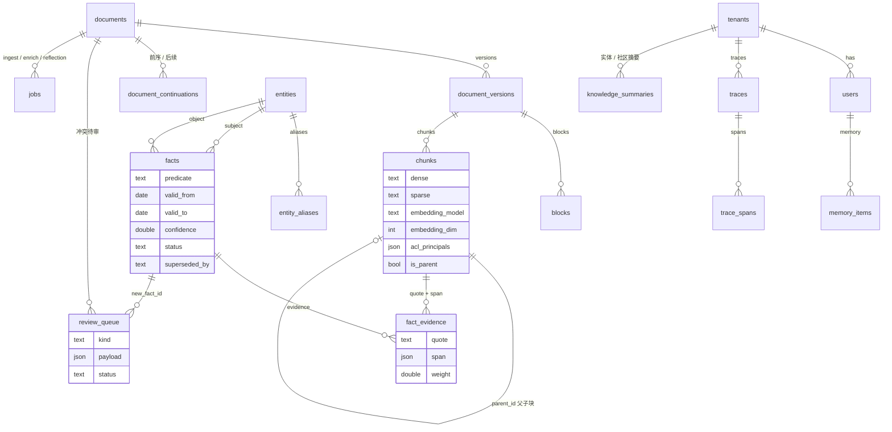
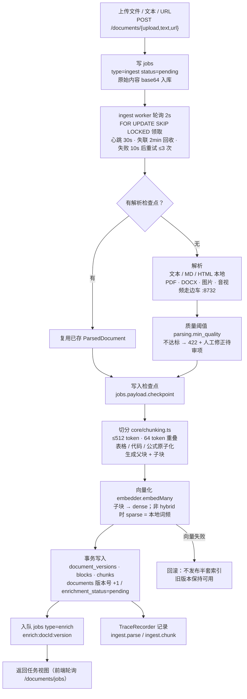
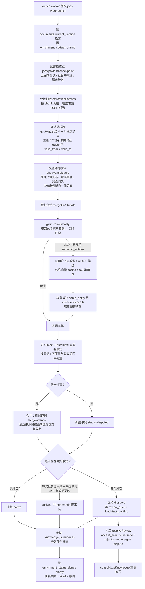
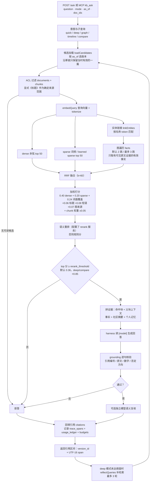

# 系统架构与数据流

依据当前代码（`src/`、`sidecar/`、`knowweave/web/`、`src/db/schema.sql`）绘制。图中端口取 `config.example.toml` 的默认值。

## 1. 系统架构

```mermaid
flowchart TB
  subgraph ACCESS["接入端"]
    UI["知识库工作台<br/>knowweave/web · 单页应用"]
    DSHUI["AI 对话页<br/>iframe 加载 DSH 原生界面"]
    CLIENT["研究台 / 脚本调用方<br/>Bearer + /api/v1"]
    MCPC["外部 MCP 客户端<br/>JSON-RPC"]
    SYNC["目录同步 CLI<br/>scripts/sync-directory"]
  end

  subgraph MAIN["主服务 · Node.js / TypeScript · Fastify :8730"]
    direction TB
    AUTH["认证与 ACL<br/>core/security.ts<br/>Bearer → Principal · tenant / user / groups"]

    subgraph ROUTES["应用层 src/app/routes"]
      R_DOC["documents<br/>upload / text / url / jobs / reprocess / trash"]
      R_ASK["ask<br/>search / ask / conversations / feedback"]
      R_LEARN["learn<br/>entities / facts / graph / review / memory / gaps"]
      R_OPS["ops<br/>stats / traces / costs / evals / prices"]
      R_MCP["mcp<br/>tools/list · tools/call"]
      R_RT["realtime<br/>WebSocket 审阅计数"]
    end

    subgraph CORE["领域核心 src/core"]
      ING["ingestion<br/>摄入队列 + 解析检查点"]
      ENQ["enrichment-queue<br/>抽取队列（续跑 / 重试）"]
      LRN["learning<br/>候选事实 → 实体 → 合并 / 取代 / 审阅"]
      ER["entity-resolution<br/>名称向量候选 + 模型裁决"]
      RET["retrieval<br/>dense + sparse + 图遍历 → RRF → 重排"]
      ANS["answering<br/>quick / deep / graph / timeline / compare"]
      GRD["grounding<br/>逐句引用核验 + 语义复核"]
      LIFE["continuation · trash · reindexing<br/>沿革 / 回收站 / 索引重建"]
      MAINT["consolidation · scheduling<br/>摘要 / 每日维护 / 回收站清理"]
      OBS["tracing · extraction-progress<br/>轨迹 / 用量 / 进度"]
    end

    subgraph ADAPTERS["适配层 src/adapters"]
      EMB["embeddings<br/>ark / openai / hybrid"]
      RRK["reranking<br/>语义服务或规则重排"]
      PRS["parsing<br/>文本 / Markdown / HTML / 文件路由"]
      SCA["sidecar 客户端<br/>拉起 / 复用 / 健康检查"]
      HARN["harness<br/>模型调用 · 重试 · 用量记账"]
      DSHW["dsh-web<br/>子进程生命周期 · 身份绑定"]
    end
  end

  subgraph EXT["外部依赖与本地进程"]
    PG[("PostgreSQL<br/>文档 / 切块 / JSONB 向量<br/>实体 / 事实 / 队列 / 轨迹")]
    FILES[("data/<br/>原始文件 · 扩展工作区")]
    LLM["[model] OpenAI 兼容接口<br/>生成 · 抽取 · 校验 · 对话"]
    EMBSVC["[embedding] 向量服务<br/>或本地 BGE-M3 /embed"]
    RRSVC["[retrieval] rerank 服务<br/>未配置则规则重排"]
    SC["Python 解析边车 :8732<br/>/parse /ocr /asr /capabilities"]
    ENG["Docling · MinerU · pypdf<br/>python-docx · OCR · ASR"]
    DSHP["DSH 原生应用 :3081<br/>流式输出 · 工具 · 会话"]
  end

  UI --> AUTH
  DSHUI --> DSHP
  CLIENT --> AUTH
  SYNC --> AUTH
  MCPC --> R_MCP
  AUTH --> ROUTES
  ROUTES --> CORE
  CORE --> ADAPTERS
  ING --> R_RT
  R_LEARN --> R_RT
  ING --> PG
  CORE --> PG
  ING --> FILES
  LIFE --> FILES
  EMB --> EMBSVC
  RRK --> RRSVC
  HARN --> LLM
  SCA --> SC
  SC --> ENG
  DSHW --> DSHP
  DSHP -->|"MCP tools/call<br/>kb_search / kb_graph / kb_query_facts …"| R_MCP
```

要点：

- 只有一个 Node 主进程承载 API、队列 worker、维护定时器和 DSH / 边车的进程管理；没有独立的消息中间件，队列就是 `jobs` 表。
- 向量以 JSONB 存在 `chunks.dense / chunks.sparse`，没有启用 pgvector。
- DSH 原生对话不直连数据库，它通过 `POST /api/v1/mcp` 回到主服务的只读工具，沿用绑定身份的知识库 ACL。

## 2. 存储视图（核心表关系）

## 3. 数据流 A：文档摄入

## 4. 数据流 B：事实与实体抽取

## 5. 数据流 C：检索与问答

## 6. 数据流 D：删除 / 恢复 / 索引重建 / 每日维护

```mermaid
flowchart TD
  subgraph TRASH["回收站"]
    A["DELETE /documents/{id}"] --> B["documents.status=tombstoned<br/>记 deleted_at / deleted_by"]
    B --> C["当场清理 chunks 与向量 · fact_evidence<br/>失去唯一出处的事实撤回<br/>只由该文档支撑的待审项关闭"]
    C --> D{"保留期 trash.retention_days"}
    D -->|"恢复"| E["用已存 blocks 重新切分 → 重新向量化<br/>→ 重新入队 enrich<br/>向量失败则不恢复"]
    D -->|"到期或手动彻底删除"| F["删除文档 / 版本 / blocks / chunks<br/>原始文件 · 孤立实体 · 引用 · 评测期望"]
  end

  subgraph REINDEX["索引重建"]
    G["POST /documents/{id}/reprocess<br/>scope=index | facts | all"] --> H["reindexing：用所有已存版本的子块重算向量<br/>事务替换，保留 chunk ID 与事实证据"]
    H -->|"向量失败"| I["不发布半套索引"]
    G --> J["scope=facts：重新入队 enrich"]
  end

  subgraph MAINT["每日维护 scheduling.ts"]
    K["reflection.run_at 默认 03:00<br/>每分钟检查，按工作区时区"] --> L["按租户领取<br/>jobs id=reflection:tenant:date"]
    L --> M["purgeExpiredTrash<br/>清理过期回收站"]
    M --> N["runReflection<br/>同名实体合并 · 冲突事实置 disputed 并补建待审项<br/>consolidateKnowledge：ACL 分区摘要重算<br/>撤回失去出处的事实 · 证据权重衰减<br/>缺口聚类 · 过期记忆清理 · 写 reflection_runs"]
    N --> O["写入 jobs 完成状态<br/>重启后补跑"]
  end
```

## 7. 关键不变量

| 项 | 约定 |
|---|---|
| 向量范围 | 只有 `chunks` 存向量；`facts` / `entities` 无向量列，靠主键关系 + 词面匹配检索 |
| 抽取期向量 | 仅 `resolveSemanticEntity` 临时嵌入实体名，用完丢弃，不落库 |
| 事实生效 | 无冲突即 `active`；只有冲突且无法按来源票自动取代才进 `review_queue` |
| 证据 | 每条事实必须挂在 `fact_evidence`，quote 是 chunk 原文子串，span 为 UTF-16 区间 |
| ACL | 文档与 chunk 各带 `acl_principals` / `acl_version`，检索与事实读取都要过 `canRead` |
| 幂等 | 同一来源内容哈希相同 → 跳过；任务领取用 `FOR UPDATE SKIP LOCKED`，抽取按 `tenant:doc:version` 去重 |
| 可观测 | 每次摄入 / 抽取 / 问答写 `traces` + `trace_spans`，模型用量写 `usage_ledger` 并累计 `budgets` |